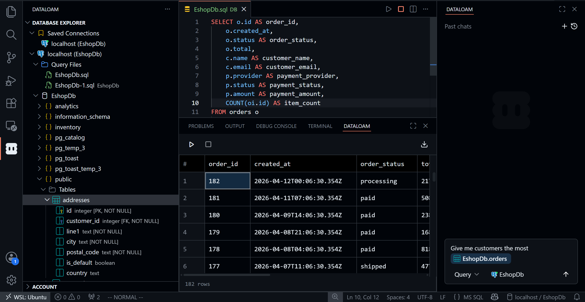
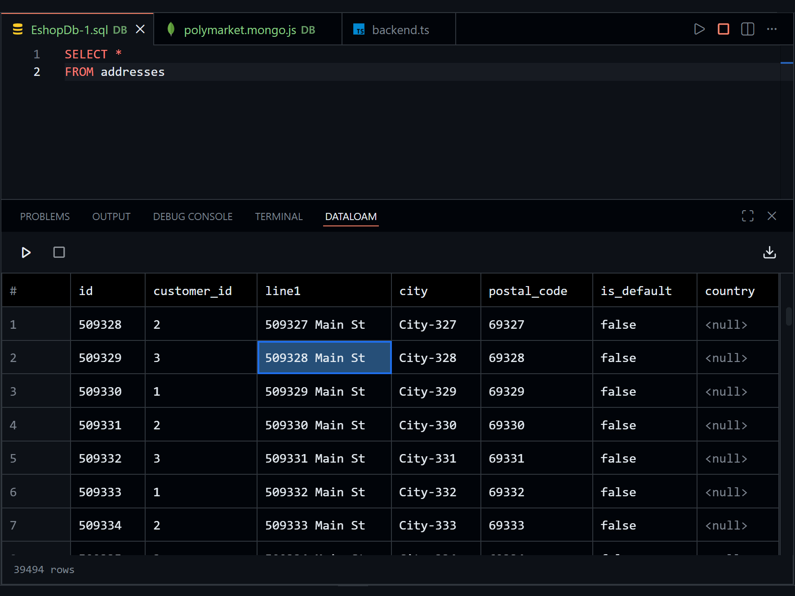
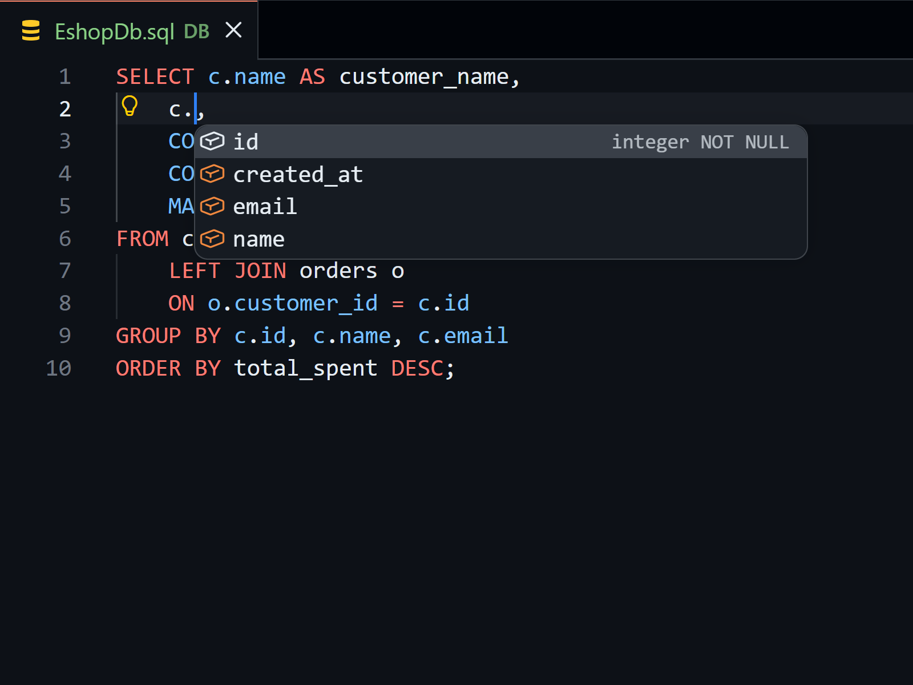
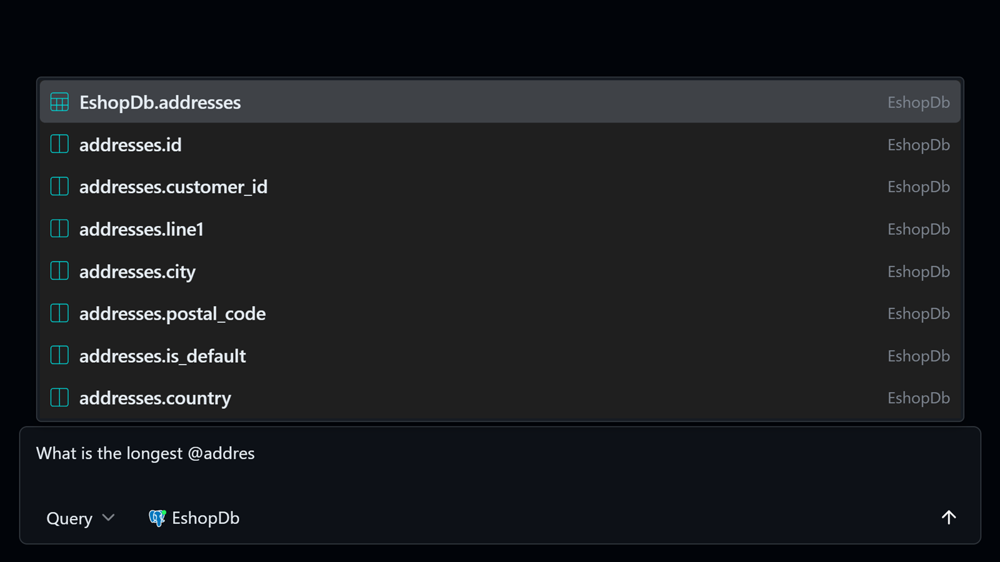
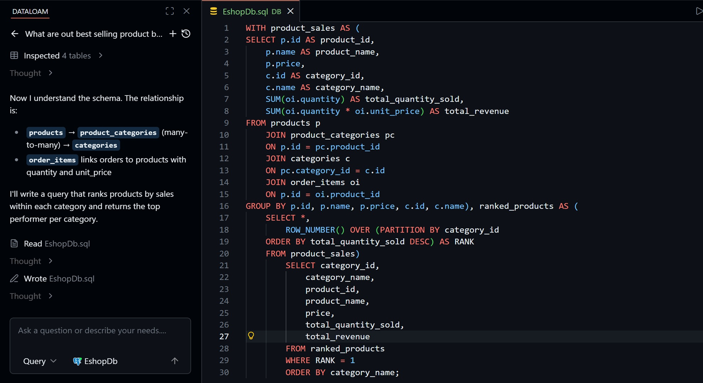
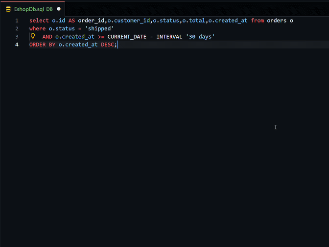
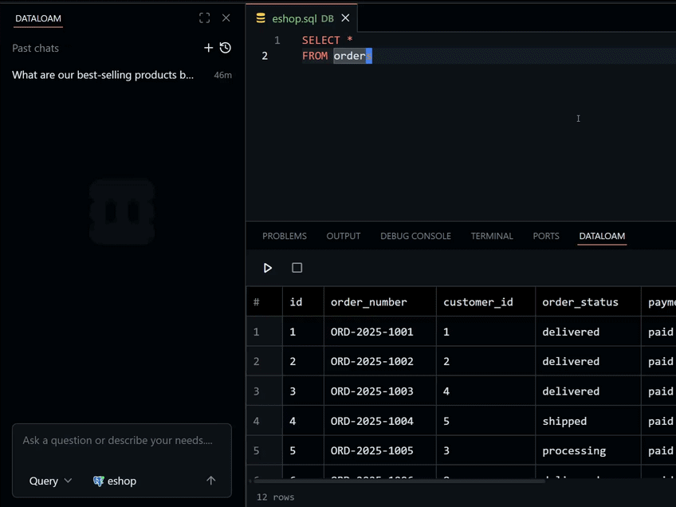
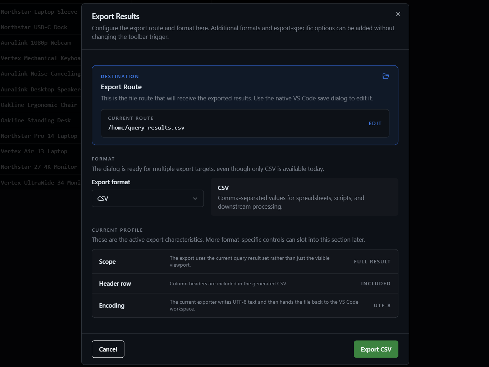

  

**A database editor for VS&nbsp;Code and Cursor with schema-aware autocomplete, query results, database navigation, and AI assistance in the same workspace.**

DataLoam keeps the database workflow inside your editor: browse connected databases, write SQL with real schema context, inspect results, format queries, export data, and ask AI for help when a query or schema gets complex.

  
  &nbsp;&nbsp;
  
  &nbsp;&nbsp;
  
  &nbsp;&nbsp;
  
  &nbsp;&nbsp;
  

  PostgreSQL · MySQL · Microsoft SQL Server · SQLite · MongoDB

## Why DataLoam

- **Editor-native database work**: open tables, inspect schemas, run queries, and review results without switching to a separate database client.
- **Schema-aware autocomplete**: get suggestions for tables, columns, and database objects while you write.
- **AI that understands your schema**: ask for queries, fixes, and explanations grounded in the database context DataLoam can see.
- **Keyboard-first workflow**: move through queries, results, and database objects without leaving the keyboard.
- **Export when needed**: move query results out of the editor when the next step belongs somewhere else.

## Work In The Editor

Browse your database, write queries, inspect results, and keep context close to the code that depends on it.

## Schema-Aware Autocomplete

DataLoam helps you write SQL against the database you are actually connected to. Suggestions are based on schema context, so column and table names are available where you need them.

## AI For Real Database Work

Use AI to generate queries, explain what a query is doing, or fix broken SQL with schema context available in the editor. The goal is not a separate chat app. It is database help where the query is being written.

## Fast SQL Editing

Format SQL directly in the editor and keep query files readable.

Navigate quickly with a workflow built for people who spend most of their day in the editor.

## Export Results

When you need to hand off data, DataLoam can export query results from the same place you ran the query.

## Supported Workflows

DataLoam is designed for daily database work across SQL and NoSQL projects:

- PostgreSQL
- MySQL
- Microsoft SQL Server
- SQLite
- MongoDB

## Links

- Website: [dataloam.io](https://www.dataloam.io)
- Documentation: [dataloam.io/docs](https://www.dataloam.io/docs)
- Pricing: [dataloam.io/pricing](https://www.dataloam.io/pricing)
- Issues: [GitHub Issues](https://github.com/VPALGO-s-r-o/DataLoam/issues/new/choose)
- Support: [support@dataloam.io](mailto:support@dataloam.io)
- Security: [SECURITY.md](SECURITY.md)

## Feedback

This repository is the public issue tracker for DataLoam. The extension itself is proprietary software by VPALGO s.r.o.; its source code is not published here. See [CONTRIBUTING.md](CONTRIBUTING.md) for how to report bugs and request features.
